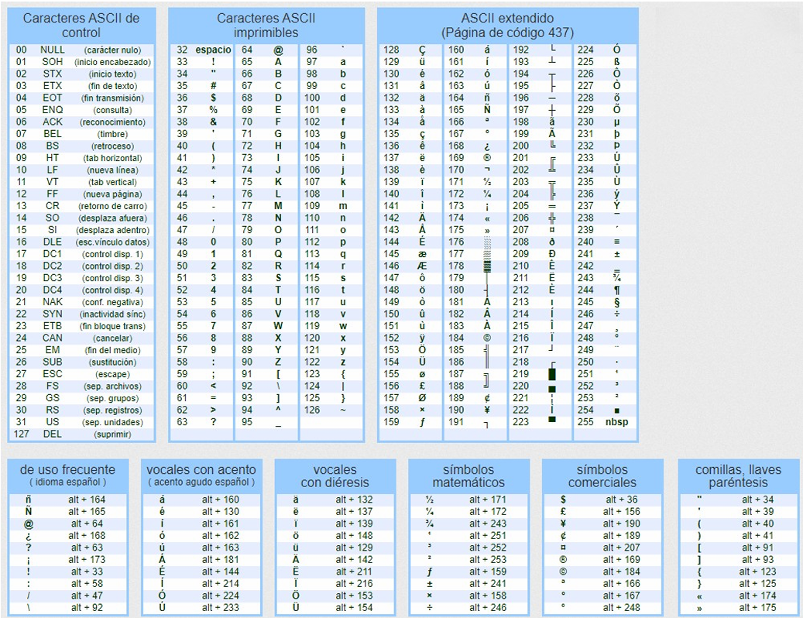
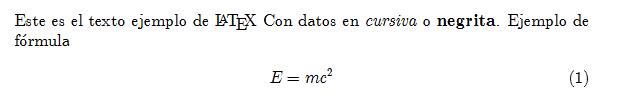
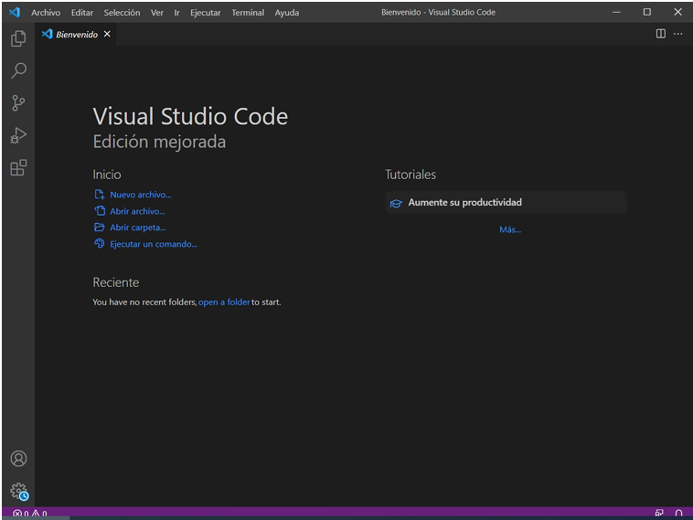
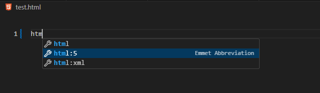
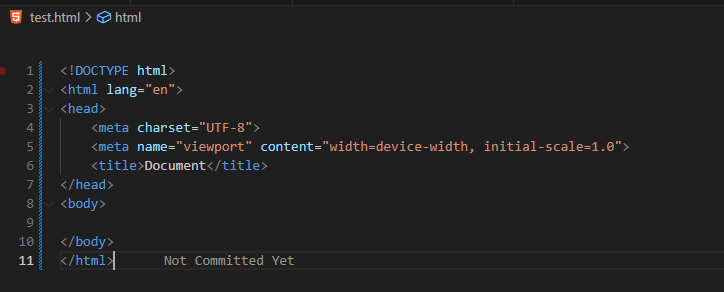
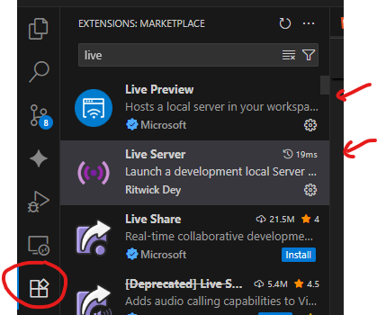
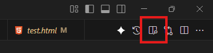
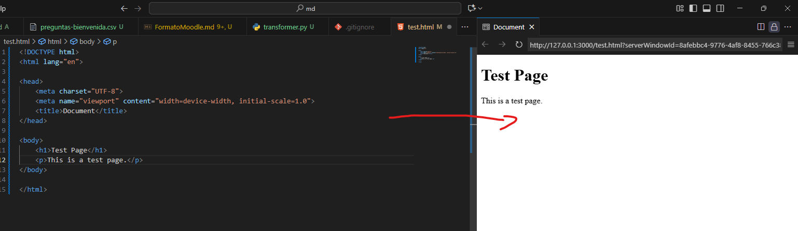

# UP01: Lenguajes de marcas y HTML inicial

> [!NOTE]
> Esta es una **versión actualizada** de los apuntes en PDF disponibles en Aules. Mantiene su estructura y contenidos, pero corrige algunos errores y actualiza la información que se había quedado desfasada en algunos aspectos menores (por ejemplo, quién mantiene hoy el estándar HTML). Si encontráis alguna diferencia, **esta versión es la de referencia**.

## Contenidos

- [Introducción](#introducción)
- [1. Información digital](#1-información-digital)
  - [1.1 Ordenadores y almacenamiento de la información](#11-ordenadores-y-almacenamiento-de-la-información)
  - [1.2 Sistemas de codificación](#12-sistemas-de-codificación)
  - [1.3 Formatos de archivo e incompatibilidades](#13-formatos-de-archivo-e-incompatibilidades)
- [2. Lenguajes de marcas](#2-lenguajes-de-marcas)
  - [2.1 Orígenes de los lenguajes de marcas](#21-orígenes-de-los-lenguajes-de-marcas)
    - [2.1.1 TeX y LaTeX](#211-tex-y-latex)
    - [2.1.2 RTF](#212-rtf)
    - [2.1.3 SGML](#213-sgml)
    - [2.1.4 HTML](#214-html)
    - [2.1.5 XML](#215-xml)
    - [2.1.6 JSON](#216-json)
    - [2.1.7 Otros lenguajes de marcas](#217-otros-lenguajes-de-marcas)
  - [2.2 Características de un lenguaje de marcas](#22-características-de-un-lenguaje-de-marcas)
  - [2.3 Tipos de lenguajes de marcas](#23-tipos-de-lenguajes-de-marcas)
  - [2.4 Organizaciones desarrolladoras de lenguajes de marcas](#24-organizaciones-desarrolladoras-de-lenguajes-de-marcas)
  - [2.5 Documentos bien formados y documentos válidos](#25-documentos-bien-formados-y-documentos-válidos)
- [3. Entorno de desarrollo o IDE](#3-entorno-de-desarrollo-o-ide)
  - [3.1 Visual Studio Code (VSCode)](#31-visual-studio-code-vscode)
    - [3.1.1 Entorno de trabajo](#311-entorno-de-trabajo)
    - [3.1.2 Atajos de teclado](#312-atajos-de-teclado)
    - [3.1.3 Secciones del IDE](#313-secciones-del-ide)
    - [3.1.4 Extensiones](#314-extensiones)
    - [3.1.5 Cambiar el tema del editor](#315-cambiar-el-tema-del-editor)
  - [3.2 Otras alternativas](#32-otras-alternativas)
- [4. ¿Qué es una aplicación web?](#4-qué-es-una-aplicación-web)
  - [4.1 ¿Qué es “la web”?](#41-qué-es-la-web)
  - [4.2 Elementos de una aplicación web](#42-elementos-de-una-aplicación-web)
  - [4.3 Funcionamiento de una aplicación web](#43-funcionamiento-de-una-aplicación-web)
  - [4.4 Dominios](#44-dominios)
  - [4.5 Protocolo HTTP](#45-protocolo-http)
  - [4.6 Lenguajes](#46-lenguajes)
- [5. Introducción al HTML](#5-introducción-al-html)

## Introducción

En esta primera unidad veremos una introducción a las características de los lenguajes de marcas, configuraremos nuestro entorno de trabajo y trataremos los aspectos básicos de HTML.

## 1. Información digital

### 1.1 Ordenadores y almacenamiento de la información

Un ordenador es toda máquina capaz de representar información mediante `unos` y `ceros`, es decir, utiliza el **sistema binario** para interpretar y almacenar la información. Por tanto, se requiere que esa información con la que trabajamos sea codificada para que sea comprensible por el ordenador.

La información con la que trabaja el ser humano utiliza el **sistema decimal** para los números y otras formas de representación mucho más complejas para texto, imágenes o música. Por ello, es necesario que toda esa información sea codificada para que un ordenador pueda procesarla.

### 1.2 Sistemas de codificación

Todo dato que no es texto se considera **dato binario** (por ejemplo, un vídeo o un programa). La forma de codificar estos datos a binario es muy variable. En las imágenes, por ejemplo, cada uno de los puntos (píxeles) se codifica de forma independiente.

> [!NOTE]
> La diferencia entre un archivo de texto y uno binario se manifiesta al abrirlos con un editor de texto. Si abrimos un archivo de texto (como un `.txt` o `.html`), su contenido será legible siempre que el editor interprete correctamente su codificación de caracteres (p. ej., UTF-8). En cambio, al abrir un archivo binario (como una imagen o un ejecutable), veremos una secuencia de caracteres sin sentido, ya que el editor intenta aplicar una codificación de texto a una secuencia de bytes que, en realidad, está estructurada según un formato de datos específico que no representa texto.

Desde el desarrollo de la escritura, el texto se convirtió en la forma más “humana” de representar la información. Dejando atrás la transmisión oral y antes de la llegada del ordenador, la información se transmitía mediante documentos o libros. Pero, ¿cómo representamos el texto en formato digital? Para ello, se codifica cada uno de los **caracteres** que lo componen. A lo largo de la historia han surgido numerosos sistemas de codificación, siendo los más conocidos el código **ASCII** y, actualmente, **Unicode**. Desde el punto de vista del ordenador, utilizar un mismo sistema de codificación (`encoding`) es como para las personas compartir un mismo alfabeto.

El código **ASCII** (American Standard Code for Information Interchange) surgió en 1963 con el objetivo de tener una codificación común para el texto. Para ello se utilizaban **7 bits**, lo que permitía obtener **128 símbolos** o caracteres distintos (2^7 = 128). Esta primera versión permitía codificar las letras del alfabeto inglés (mayúsculas y minúsculas), los números del 0 al 9 y algunos símbolos de puntuación. Sin embargo, esto no era suficiente, ya que no era posible codificar todos los caracteres (faltaban la "ñ", las letras acentuadas, etc.). Por ello, se pasó a utilizar **8 bits**, dando lugar a los llamados **códigos ASCII extendidos**.



Aun así, 8 bits seguían siendo insuficientes para representar todos los alfabetos del planeta. La solución fue que cada región usara su propia tabla ASCII extendida, compartiendo los 128 caracteres originales. Por ejemplo, **ISO-8859-1** es el sistema ASCII extendido para Europa Occidental, que incluye símbolos como la letra "ñ". Otros sistemas populares son **WINDOWS-1252** (similar a ISO-8859-1, pero con algunos caracteres adicionales) o **ISO-8859-15** (que añade el símbolo del euro a ISO-8859-1).

El problema de esta codificación es que, al editar un documento, se debe especificar el sistema de codificación utilizado para que el programa que lo lea sepa cómo interpretarlo, y un mismo byte significa cosas distintas en cada tabla. **Unicode** resuelve esto con un único catálogo que asigna un número (llamado *punto de código*) a los caracteres de prácticamente todas las lenguas del planeta, además de símbolos matemáticos, lenguas muertas o emojis. Para mantener la compatibilidad, los primeros 128 caracteres coinciden con el ASCII original y los 128 siguientes con ISO-8859-1.

Unicode dice **qué número** tiene cada carácter, pero no cómo se guarda ese número en bytes. De eso se encargan las distintas codificaciones **UTF (Unicode Transformation Format)**:

- **UTF-8**: Utiliza de 1 a 4 bytes por carácter: 1 byte para los caracteres ASCII, 2 para la mayoría de alfabetos europeos (incluidas la "ñ" y las vocales acentuadas), el griego o el cirílico, 3 para el chino o el japonés y 4 para el resto (emojis, símbolos poco frecuentes, etc.). Es compatible con ASCII y es la codificación más utilizada en la web.
- **UTF-16**: Utiliza 2 o 4 bytes por carácter. Es común en aplicaciones de Windows y en ciertos sistemas de bases de datos.
- **UTF-32**: Utiliza 4 bytes por carácter. Es menos común debido a su mayor tamaño, pero es útil en aplicaciones que requieren acceso rápido a caracteres individuales.

Hoy **UTF-8 es el estándar de facto**: lo usa la inmensa mayoría de páginas web y es la codificación que exige HTML. Sin embargo, las codificaciones antiguas siguen ahí: archivos heredados, bases de datos antiguas o el CSV que exporta Excel en Windows usan a menudo **Windows-1252**. Por eso **no debemos dar por supuesta la codificación**: hay que declararla siempre (en HTML, con `<meta charset="UTF-8">`, que veremos más adelante) y comprobarla al abrir archivos de otras fuentes. Si se lee un texto con una codificación distinta a la que se usó al guardarlo, aparecen caracteres extraños, como "España" en lugar de "España".

> [!TIP]
> **Ampliación (no es necesaria para superar la unidad): ¿cómo sabe UTF-8 cuántos bytes ocupa cada carácter?**
>
> Los caracteres ASCII van del 0 al 127, así que caben en **7 bits**. Como un byte tiene 8, UTF-8 usa el primer bit como señal:
>
> | Bytes | Patrón de bits | Bits útiles | Caracteres |
> |---|---|---|---|
> | 1 | `0xxxxxxx` | 7 | 0 – 127 (exactamente ASCII) |
> | 2 | `110xxxxx 10xxxxxx` | 11 | hasta 2.047 |
> | 3 | `1110xxxx 10xxxxxx 10xxxxxx` | 16 | hasta 65.535 |
> | 4 | `11110xxx 10xxxxxx 10xxxxxx 10xxxxxx` | 21 | hasta ~1,1 millones |
>
> Si un byte empieza por `0`, es un carácter completo e idéntico al ASCII; por eso cualquier texto ASCII es también UTF-8 válido. La "ñ", en cambio, ocupa la posición 241 de Unicode: no cabe en 7 bits, así que UTF-8 la guarda en dos bytes (`C3 B1`). Si un programa lee esos dos bytes creyendo que el texto está en ISO-8859-1 o Windows-1252, los interpreta como dos caracteres distintos (`C3` = "Ã" y `B1` = "±"): de ahí el "España" que veíamos arriba. Fíjate que si usásemos los 8 bits de un byte para codificar la "ñ", no habría forma de distinguirla de otros caracteres, que necesiten de más de un byte. Por eso UTF-8 usa el primer bit como señal: si es `0`, es un carácter ASCII; si es `1`, hay que leer más bytes para completar el carácter.

### 1.3 Formatos de archivo e incompatibilidades

Todos los archivos, sean de texto o binarios, se almacenan como una secuencia de bits (unos y ceros) agrupados en grupos de 8, llamados **bytes**. La diferencia está en cómo se interpretan esos bytes: en un archivo de texto representan caracteres según una codificación conocida, mientras que en un archivo binario siguen un formato propio del programa que los creó, ya sea para visualizar una imagen o para ejecutar un programa. Por eso, si el programa que utilizamos para abrir el archivo es diferente al que lo generó, puede producirse un error de **incompatibilidad**. Es decir, los **archivos binarios** dependen del software que los crea y del sistema operativo utilizado.

Por otro lado, tenemos los **archivos de texto**. Un archivo `.txt` generado en nuestro ordenador se podrá abrir independientemente del sistema operativo (macOS, Linux o Windows). El problema surge cuando queremos darle formato al texto (añadir color, cambiar el tipo de letra, insertar imágenes, etc.), ya que esta información de formato se debe guardar en un formato binario junto al texto. Esto generaba problemas de incompatibilidad, y es aquí donde los **lenguajes de marcas** cobran importancia.

## 2. Lenguajes de marcas

Cuando queremos almacenar información, como un documento de trabajo o un manual, podemos hacerlo de distintas formas. Podríamos emplear un editor de texto avanzado como Microsoft Word o LibreOffice Writer, pero tendríamos el inconveniente de no poder consultar el documento sin tener el software instalado, ya que al intentar abrirlo con un programa diferente, podría no visualizarse correctamente por problemas de incompatibilidad.

Los **lenguajes de marcas** nos permiten añadir anotaciones en un documento de texto que hacen referencia tanto al **formato** del documento (tipo y tamaño de letra, color, etc.) como a la **estructura** de la información, añadiendo marcas o etiquetas que indican qué tipo de contenido estamos almacenando.

> [!NOTE]
> Después de leer esto... ¿Consideráis que un archivo `.docx` es un archivo de texto o binario?

### 2.1 Orígenes de los lenguajes de marcas

**Charles Goldfarb**, considerado el padre de los lenguajes de marcas, propuso la idea de que los documentos de texto indicaran su propio formato. Para ello, sugirió añadir **marcas** o **etiquetas** al texto. A este enfoque se le conoce como **"marcado"**.

El primer lenguaje de marcas fue el **Generalized Markup Language (GML)**, desarrollado por Goldfarb en IBM en los años 60. Este lenguaje fue la base para el desarrollo del estándar **Standard Generalized Markup Language (SGML)** en 1986 por la ISO (Organización Internacional de Normalización). SGML es un lenguaje muy potente y complejo que permitió definir otros lenguajes de marcas más sencillos y específicos, como **HTML (HyperText Markup Language)** y **XML (eXtensible Markup Language)**. Ambos han tenido un gran impacto en la forma en que se maneja la información en la web y en el software.

#### 2.1.1 TeX y LaTeX

En los años 70, **Donald Knuth** creó **TeX**, un sistema que permitía que los documentos científicos se vieran igual en cualquier ordenador, utilizando la misma tipografía y permitiendo representar fórmulas matemáticas complejas. Para ello, se añadían marcas al texto que informaban al programa sobre cómo debía mostrarse. En 1984, **Leslie Lamport** creó **LaTeX**, un conjunto de macros sobre TeX que simplifica su uso y que hoy sigue siendo el estándar para documentos científicos. Un ejemplo de código **LaTeX**:

```latex
\documentclass[12pt]{article} 
\usepackage{amsmath} 
\title{Ejemplo} 
\begin{document} 
\maketitle 
Este es el texto ejemplo de \LaTeX{} 
Con datos en \emph{cursiva} o \textbf{negrita}. 
Ejemplo de fórmula 
\begin{align} 
E &= mc^2 
\end{align} 
\end{document} 
```

Como podemos ver, se especifican detalles como el tamaño de la letra, si es cursiva o negrita, etc. El resultado sería:



#### 2.1.2 RTF

**RTF (Rich Text Format)** es un lenguaje de marcas de presentación creado por Microsoft en 1987. Su objetivo era ser un formato de intercambio universal que permitiera a distintos procesadores de texto compartir documentos conservando formatos básicos como negritas, cursivas, fuentes y tamaños de letra.

Aunque en su día fue muy popular, hoy se considera un formato **obsoleto (legacy)**. Ha sido superado por estándares más modernos como **DOCX** para la edición y **PDF** para la distribución. Su uso actual es muy limitado.

#### 2.1.3 SGML

**SGML** fue un lenguaje de marcado definido por la ISO como el estándar mundial para documentos de texto con etiquetas. Es considerado el "padre" de **XML** y la base sobre la que se sostiene **HTML**. En SGML, las etiquetas se colocan entre los símbolos `<` y `>` y se cierran con el signo `/`, reglas que los lenguajes de etiquetado actuales heredaron. En realidad, al igual que XML, no es un lenguaje con etiquetas concretas, sino un metalenguaje que sirve para definir otros lenguajes de etiquetado. De todos los lenguajes definidos mediante SGML, **HTML** es el más popular.

#### 2.1.4 HTML

**Tim Berners-Lee** utilizó SGML para definir un nuevo lenguaje de etiquetas que llamó **HTML (HyperText Markup Language)**. HTML fue diseñado para intercambiar información académica a través de internet. Durante años, el **World Wide Web Consortium (W3C)** se encargó de publicar sus versiones (HTML 4.01, XHTML, HTML5…), y HTML fue aceptado como norma ISO en el año 2000. Desde 2019, la especificación oficial es el **HTML Living Standard**, mantenido por el **WHATWG** (grupo formado por los fabricantes de navegadores), que se actualiza de forma continua y ya no tiene números de versión. Por costumbre, se sigue llamando **HTML5** a este HTML moderno. Las etiquetas de HTML están pensadas para la **organización lógica** del contenido (títulos, párrafos, tablas, etc.) y no tanto para su presentación. Por ello, el W3C ideó las **hojas de estilo (CSS)**.

#### 2.1.5 XML

**XML (eXtensible Markup Language)** es un lenguaje creado para mejorar SGML y definir lenguajes de marcado con una sintaxis más estricta pero más comprensible. Ha sido uno de los lenguajes más utilizados para importar y exportar información.

#### 2.1.6 JSON

**JSON (JavaScript Object Notation)** es una notación de datos procedente del lenguaje JavaScript. **Douglas Crockford** la popularizó a principios de los 2000 y, a partir de 2009, los navegadores empezaron a incluir soporte nativo para leerla y generarla, lo que impulsó su popularidad hasta competir directamente con XML. Hoy en día es el formato más utilizado para intercambiar información en la web. JSON no se considera un lenguaje de marcas, ya que no utiliza etiquetas, sino que divide el texto en **pares de clave-valor (metadato y dato)**. Por ello, se le conoce como una **notación**. Por ejemplo:

```json
[
  {
    "nombre": "Ana",
    "edad": 28,
    "ciudad": "Madrid"
  },
  {
    "nombre": "Luis",
    "edad": 34,
    "ciudad": "Barcelona"
  },
  {
    "nombre": "Francisco",
    "edad": 30,
    "ciudad": "Valencia"
  }
]
```

#### 2.1.7 Otros lenguajes de marcas

No me gustaría concluir esta sección sin mencionar otros lenguajes que seguramente os encontraréis en el futuro:

- **YAML (YAML Ain't Markup Language)**: Un lenguaje de serialización de datos legible por humanos, muy utilizado para archivos de configuración. Por ejemplo, los archivos `docker-compose.yml` utilizan YAML.
- **Markdown**: Un lenguaje de marcado ligero para formatear texto de manera sencilla. Es muy popular en documentación de software, blogs y plataformas como GitHub. Es el que se utiliza para los archivos `README.md` y para buena parte del material de este curso 😉.

### 2.2 Características de un lenguaje de marcas

Las características generales que debe cumplir un lenguaje de marcas son:

- Deben definir la información en **archivos de texto plano**, para que sean fáciles de exportar y utilizar entre diferentes aplicaciones y sistemas operativos.
- Deben mostrar información de forma **compacta**, intercalando las etiquetas con la información a almacenar.
- Deben poder **coexistir con otros lenguajes** en un mismo documento. Por ejemplo, un archivo HTML puede contener código JavaScript o PHP.
- **No son lenguajes de programación**, ya que carecen de estructuras como variables, bucles o funciones. Son lenguajes para etiquetar y estructurar información.

> [!CAUTION]
> ¡**HTML NO es un lenguaje de programación**! Como informáticos, confío en que habléis con propiedad 😉.

### 2.3 Tipos de lenguajes de marcas

La forma más clara de clasificar los lenguajes de marcas es según su propósito: ¿describen **qué es** la información o **cómo se ve**?

- **Lenguajes de Presentación (Presentational Markup)**: Su única función es describir la **apariencia** del contenido, sin aportar información sobre su significado o estructura. Responden a la pregunta: *¿Cómo se debe ver esto?*
  - **Ejemplo principal**: **RTF (Rich Text Format)**. Almacena instrucciones como "esto va en negrita" o "usa la fuente Arial tamaño 12".
  - Las etiquetas `<font>` o `<center>` del HTML antiguo también eran puramente de presentación (hoy están obsoletas). Otras como `<b>` o `<i>` nacieron con ese fin, pero HTML5 las redefinió con un significado propio.

- **Lenguajes Descriptivos o Estructurales (Descriptive/Structural Markup)**: Describen la **estructura y el significado semántico** del contenido, pero no su apariencia. Responden a la pregunta: *¿Qué es esta información?* La forma en que se mostrará se define en otro lugar (por ejemplo, en una hoja de estilos).
  - **Ejemplo puro**: **XML (eXtensible Markup Language)**. Permite crear etiquetas que describen los datos, como `<nombre>`, `<apellido>` o `<precio>`, sin indicar cómo deben mostrarse.
  - **Caso cercano**: **JSON (JavaScript Object Notation)**. Como vimos, no es un lenguaje de marcas porque no usa etiquetas, pero comparte este mismo propósito: describir la estructura de los datos, no su apariencia.
  - **Y también**: **LaTeX**. Se usa para documentos académicos. Al escribir `\section{Introducción}`, se indica que es una sección, y el sistema se encarga de formatearla, pero la etiqueta en sí es puramente estructural.

#### El Caso Especial de HTML: De Híbrido a la Separación de Conceptos

HTML es el mejor ejemplo para entender la evolución de estos conceptos:

1. **En su origen, HTML era un lenguaje estructural.** Tenía etiquetas para definir la estructura de un documento, como títulos (`<h1>`), párrafos (`<p>`) y listas (`<ul>`).

2. **Pronto se convirtió en un lenguaje híbrido.** Se añadieron etiquetas de presentación como `<font color="red">` o `<center>`, lo que mezclaba la estructura con la presentación y dificultaba el mantenimiento del código.

3. **Hoy en día, la buena práctica es la "Separación de Conceptos" (Separation of Concerns).** Se vuelve a usar HTML como un lenguaje puramente **estructural y semántico**, y toda la presentación se delega en un lenguaje específico para ello: **CSS (Cascading Style Sheets)**.

    - ✅ **Correcto (Separado):**
      - **HTML (Estructura):** `<h1>Mi Título</h1>`
      - **CSS (Presentación):** `h1 { color: blue; text-align: center; }`

    - ❌ **Incorrecto (Híbrido y obsoleto):**
      - `<center><h1><font color="blue">Mi Título</font></h1></center>`

Esta separación es un **principio fundamental** en el desarrollo web moderno que veréis constantemente en este módulo.

### 2.4 Organizaciones desarrolladoras de lenguajes de marcas

- **ISO (Organización Internacional de Normalización)**: Con sede en Ginebra (Suiza), se creó en 1947. Sus normas son voluntarias. Tras el éxito de GML, en 1986 publicó el **Standard Generalized Markup Language (SGML)** como el estándar internacional ISO 8879.
- **World Wide Web Consortium (W3C)**: Creado en 1994 por **Tim Berners-Lee**, su función principal es tutelar el crecimiento y la organización de la web. Publicó las versiones de **HTML** hasta HTML 5.2 (2017), creó **XML** en 1998 y hoy sigue a cargo de muchos estándares que veremos en el curso, como **CSS**, **XML**, **XPath**, **XSLT** o **SVG**.
- **WHATWG (Web Hypertext Application Technology Working Group)**: Creado en 2004 por Apple, Mozilla y Opera, al que después se unió Google y Microsoft. Desde 2019 es el responsable de la especificación oficial de **HTML**, el *HTML Living Standard*.

### 2.5 Documentos bien formados y documentos válidos

Para que un programa pueda procesar un documento de marcas sin ambigüedades, este debe seguir unas reglas. Distinguimos dos niveles:

- Un documento está **bien formado** cuando respeta las reglas sintácticas generales del lenguaje. En XML, por ejemplo: tiene un **único elemento raíz**, todas las etiquetas **se cierran**, están **correctamente anidadas** (la última en abrirse es la primera en cerrarse), se respetan **mayúsculas y minúsculas** y los valores de los atributos van **entre comillas**.
- Un documento es **válido** cuando, además de estar bien formado, cumple las reglas de una **gramática** concreta que indica qué elementos y atributos se permiten y en qué orden (en XML, mediante una **DTD** o un **XML Schema**, que veremos más adelante en el curso).

Todo documento válido está bien formado, pero no al revés. Por ejemplo, este documento XML está bien formado, pero si su gramática exigiera que todo `<alumno>` tuviera un `<email>`, no sería válido:

```xml
<?xml version="1.0" encoding="UTF-8"?>
<clase>
  <alumno id="1">
    <nombre>Ana</nombre>
  </alumno>
</clase>
```

En cambio, `<nombre>Ana</Nombre>` o `<b><i>texto</b></i>` romperían la buena formación.

> [!NOTE]
> Los navegadores son muy permisivos con HTML y "arreglan" muchos errores por su cuenta, pero eso no significa que el código sea correcto. Escribir documentos bien formados y comprobarlos con un validador es una buena práctica que evita resultados inesperados. En los contenidos de Eniun de esta unidad veréis las reglas concretas de HTML5 y XHTML.

## 3. Entorno de desarrollo o IDE

Para trabajar con lenguajes de marcas, podemos utilizar editores o herramientas software que nos faciliten el proceso. Vamos a ver algunos de ellos, centrándonos en el que utilizaremos a lo largo del curso.

### 3.1 Visual Studio Code (VSCode)

Es un editor de texto desarrollado por Microsoft para Windows, Linux y macOS. Es compatible con múltiples lenguajes de programación y cuenta con un amplio conjunto de **extensiones** que facilitan enormemente la programación. A lo largo de este curso, utilizaremos este editor.

Podemos descargarlo desde su [página oficial](https://code.visualstudio.com/).

> [!NOTE]
> **IDE (Integrated Development Environment)**: Estrictamente, VSCode no es un IDE, sino un editor de texto avanzado. Sin embargo, gracias a su gran capacidad de ampliación mediante extensiones, puede configurarse para funcionar como un IDE completo, como haremos en este curso. Es popular, ligero, gratuito y multiplataforma.

#### 3.1.1 Entorno de trabajo

Al crear un nuevo archivo, VSCode nos permite seleccionar el lenguaje para empezar a trabajar. En nuestro caso, seleccionaremos **HTML**, y el editor nos ayudará con las etiquetas y la sintaxis.



#### 3.1.2 Atajos de teclado

VSCode ofrece múltiples atajos de teclado que nos facilitan el desarrollo. Por ejemplo, si en un archivo HTML vacío escribimos `html:5` y pulsamos `Enter`, se generará automáticamente la estructura básica de un documento HTML. Esto es gracias a una herramienta integrada llamada **Emmet**.




Otro atajo muy útil es el de **formatear el documento** (indentarlo correctamente) con el comando `Shift + Alt + F` en Windows (`Shift + Option + F` en macOS y `Ctrl + Shift + I` en Linux).

#### 3.1.3 Secciones del IDE

Las partes principales de VSCode son:

1. **Editor**: Es la parte central donde editamos nuestros archivos. Permite tener varios archivos abiertos en pestañas y dividir la ventana para ver varios archivos a la vez.
2. **Panel lateral**: Muestra diferentes vistas, como el explorador de archivos, el control de versiones (Git), la búsqueda, la depuración y las extensiones.
3. **Barra de actividades**: Es la barra vertical a la izquierda con iconos para cambiar entre las vistas del panel lateral.
4. **Barra de estado**: La barra inferior que muestra información útil, como el número de línea, la rama de Git, etc.
5. **Paneles inferiores**: Muestran la terminal integrada, la salida de depuración, los errores y las advertencias.

#### 3.1.4 Extensiones

Una de las características más potentes de VSCode es su **Marketplace de extensiones**, que permite añadir nuevas funcionalidades, temas y soporte para diferentes lenguajes. Algunas de las extensiones que utilizaremos son:

- **Live Preview**: Permite previsualizar en tiempo real los cambios que hacemos en nuestro código HTML. Cada vez que guardamos, la vista previa se actualiza automáticamente. Una alternativa popular es **Live Server**.
- **Spanish Language Pack for Visual Studio Code**: Traduce la interfaz de VSCode al español.

Para instalar una extensión, id al icono de **Extensiones** en la barra de actividades, buscad la que necesitéis y pulsad **Instalar**.



Para usar **Live Preview**, una vez instalada, simplemente pulsad el icono de la lupa que aparece en la esquina superior derecha del editor.



Esto abrirá una nueva pestaña con la vista previa de vuestra página web, que se actualizará automáticamente al guardar los cambios.



#### 3.1.5 Cambiar el tema del editor

Si queremos modificar el tema del editor que viene por defecto debemos ir a `File > Preferences > Theme > Color Theme` (en macOS, `Code > Settings > Theme > Color Theme`) o pulsar `Ctrl + K` seguido de `Ctrl + T`, y elegir el estilo con el que más cómodos estemos.

### 3.2 Otras alternativas

- **JetBrains WebStorm**: Un IDE comercial muy potente, especializado en JavaScript y tecnologías web. Es muy popular entre desarrolladores que usan frameworks como React, Angular o Vue.js. Es gratuito para estudiantes y para uso no comercial.
- **Cursor / Windsurf**: Son `forks` de VSCode que integran potentes capacidades de programación asistida por IA.
- **VSCodium**: Versión de VSCode compilada a partir de su código abierto, sin la telemetría de Microsoft.
- **Vim / Neovim**: Editores de texto avanzados y muy eficientes, pero con una curva de aprendizaje pronunciada. No son recomendados para principiantes.

## 4. ¿Qué es una aplicación web?

Según Wikipedia, una **aplicación web** es una herramienta que los usuarios pueden utilizar accediendo a un **servidor web** a través de internet o una intranet mediante un **navegador**. Este término se aplica a programas que se ejecutan en el entorno del navegador, incluyendo también las **aplicaciones híbridas** y las **aplicaciones de escritorio** que utilizan tecnologías web.

### 4.1 ¿Qué es “la web”?

La **web** es el diminutivo de **World Wide Web (WWW)**, cuyas tecnologías fundacionales (HTML, URL, HTTP) fueron desarrolladas en 1990 por **Tim Berners-Lee**.

### 4.2 Elementos de una aplicación web

En una aplicación web distinguimos dos partes principales:

- El **cliente**: Es el dispositivo del usuario final que consume los recursos. Para ello, utiliza un **navegador web** para acceder a la aplicación.
- El **servidor**: Es el ordenador encargado de atender las peticiones de los clientes y servirles la información que solicitan.

### 4.3 Funcionamiento de una aplicación web

Para acceder a un servidor web, es imprescindible conocer su **dirección IP**, que es el número que identifica a un ordenador en una red TCP/IP como internet. Una dirección IP (versión 4) es un número de 32 bits que se expresa como cuatro números del 0 al 255, separados por puntos. Por ejemplo, una de las direcciones IP de Google es `142.250.184.3`.

### 4.4 Dominios

Como recordar direcciones IP es muy difícil, se ideó el **Servicio de Nombres de Dominio (DNS)**. Un **dominio de internet** es un nombre único que identifica a un equipo en la red, siendo mucho más fácil de recordar que una dirección IP (por ejemplo, `google.com`).

### 4.5 Protocolo HTTP

El **protocolo HTTP (HyperText Transfer Protocol)** es el encargado de gestionar el intercambio de información entre el servidor y el cliente. Cuando queremos acceder a una página, debemos indicar el protocolo que vamos a utilizar junto con el nombre del dominio. El conjunto de `protocolo + dominio + ruta` se denomina **URL (Uniform Resource Locator)**.

Por ejemplo: `https://portal.edu.gva.es/03013224/va/fp-semipresencial-va/`

Una URL comienza con el nombre de su **esquema** (como `http`, `https`, `ftp`, `mailto`), seguido de dos puntos.

### 4.6 Lenguajes

En una aplicación web, los lenguajes se pueden clasificar según dónde se ejecutan:

1. **Lenguajes de servidor**: Se ejecutan en el servidor para procesar peticiones del cliente. Algunos ejemplos son **PHP**, **Python**, **Java**, **C#** (con ASP.NET) y, hoy en día, también **JavaScript** gracias a entornos de ejecución como **Node.js**.
2. **Lenguajes de cliente**: Se ejecutan en el navegador del cliente para que pueda ver la aplicación e interactuar con ella. Aquí encontramos **HTML** y **CSS** para la estructura y el diseño, y **JavaScript** para la interactividad. También es habitual escribir en **TypeScript**, que se traduce a JavaScript antes de llegar al navegador.

## 5. Introducción al HTML

Para trabajar los contenidos más prácticos de esta unidad, vamos a utilizar la web de **Eniun**: [https://eniun.com/](https://eniun.com/).

> [!NOTE]
> **Eniun** pertenece a **Andrea**, compañera docente en nuestro centro. Su contenido se actualiza constantemente para cubrir los aspectos más relevantes del módulo LMSGI, adaptándose al contexto empresarial de la zona.

**Recomendaciones**:

- Leed detenidamente el contenido proporcionado y realizad los ejercicios de ejemplo.
- Probad todo el código de los ejemplos en vuestro editor. Os recomiendo **Visual Studio Code** con la extensión **Live Preview** o **Live Server**.
- Utilizad las abreviaciones de **Emmet** para escribir HTML más rápido.

Cuando terminéis, realizad los **ejercicios prácticos** disponibles en Aules. Además de los obligatorios, encontraréis ejercicios de refuerzo y ampliación que, aunque no son evaluables, son muy recomendables.

Es muy importante que reviséis los resultados de vuestros tests, ya que la prueba objetiva trimestral será similar a los ejercicios y tests de Aules.

**Contenidos prácticos interactivos (Eniun):**

A continuación, tenéis los enlaces a los contenidos que **debéis leer y practicar**:

- [1. Lenguajes de marcado](https://www.eniun.com/introduccion-lenguajes-de-marcado/)
- [2. Lenguaje de marcas HTML](https://www.eniun.com/html-lenguaje-de-marcas/)
  - [2.1 Reglas y normas](https://www.eniun.com/reglas-normas-html5/)
  - [2.2. Cierre de etiquetas](https://www.eniun.com/cierre-etiquetas-html5-uso-slash-barra-inclinada/)
- [3. Estructura y elementos semánticos](https://www.eniun.com/html5-estructura-basica-elementos-semanticos/)
- [4. Tutorial Visual Studio Code](https://www.eniun.com/curso-visual-studio-code/)
