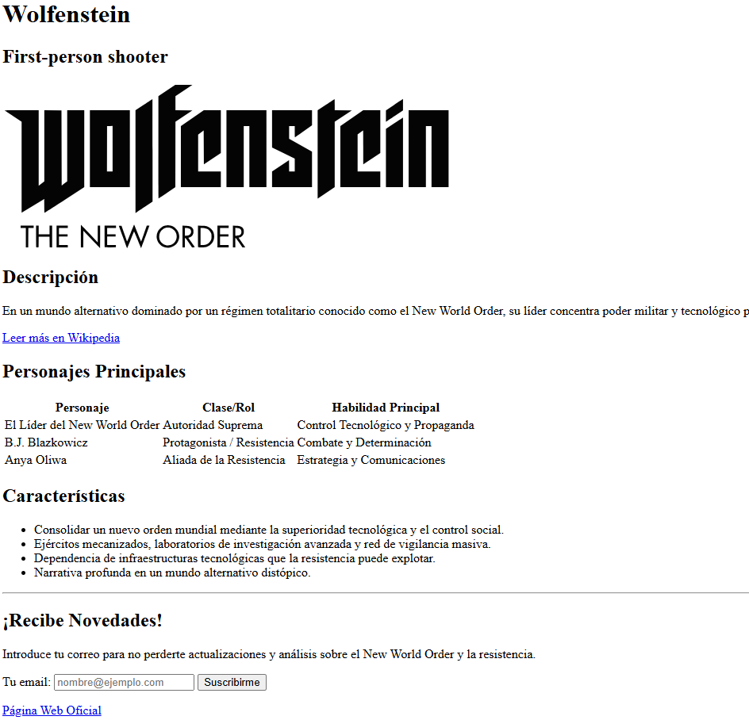
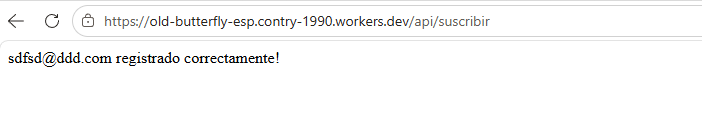

# UP02: HTML I

## Introducción

En esta unidad seguimos trabajando con HTML: etiquetas de contenido de texto, formularios, tablas y contenido incrustado. Igual que en la UP01, los contenidos prácticos están en la web de **Eniun**.

**Recomendaciones**:

- Leed detenidamente el contenido proporcionado y realizad los ejercicios de ejemplo. Algunos podéis verlos directamente en línea desde CodePen.
- Probad todo el código de los ejemplos en vuestro editor y haced cambios sobre él para hacer vuestras propias pruebas. Os recomiendo **Visual Studio Code** con la extensión **Live Preview** o **Live Server**.
- Utilizad las abreviaciones de **Emmet** para escribir HTML más rápido.
- Realizad los ejercicios de refuerzo que encontraréis al final de cada sección.

Cuando terminéis, realizad las **actividades** disponibles en Aules. Además de los ejercicios obligatorios, encontraréis ejercicios de refuerzo y ampliación que, aunque no son evaluables, son muy recomendables.

Es muy importante que reviséis y comprendáis los resultados de vuestros tests, ya que la prueba objetiva trimestral será similar a los tests y ejercicios de Aules y a los ejercicios resueltos y propuestos en el contenido de Eniun.

## Contenidos prácticos interactivos (Eniun)

A continuación, tenéis los enlaces a los contenidos que **debéis leer y practicar**:

- [5. Etiquetas de contenido de texto HTML](https://www.eniun.com/etiquetas-contenido-texto-html/)
- [6. Etiquetas de formularios HTML5](https://www.eniun.com/etiquetas-formularios-html5/)
- [7. Etiquetas de tablas de contenido HTML5](https://www.eniun.com/etiquetas-tablas-contenido-html5/)
- [8. Contenido incrustado HTML5](https://www.eniun.com/contenido-incrustado-html5/)

*Los puntos del 1 al 4 ya los vimos en la [UP01](UP01.md).*

## Actividades formativas de la unidad

> [!IMPORTANT]
> Estas actividades **NO son evaluables** y **no hay que entregarlas**. Son ejercicios para practicar lo que habéis visto en Eniun antes de hacer las actividades de Aules. Al final de cada una tenéis una **solución de ejemplo**: intentad hacerla primero por vuestra cuenta y usad la solución solo para comparar.

### 1. Ejercicios de maquetación web con HTML

Se proponen dos actividades para realizar de forma secuencial. La primera se centra en la maquetación de contenido estático y visual, y la segunda añade un componente interactivo a la página creada mediante formularios.

#### Actividad 1: Ficha técnica visual

**Objetivo**

Practicar la maquetación de contenido: estructurar información con encabezados y párrafos, incrustar imágenes, crear enlaces a recursos externos y organizar datos en tablas y listas.

**Planteamiento**

Elige un videojuego, película o serie que te guste y crea una ficha técnica visual. Además de estructurar el texto, añadirás una imagen de portada y enlaces a sitios de interés para que la página sea más completa.

**Tareas**

1. **Título y género**: añade un `<h1>` con el nombre y un `<h2>` con su género.
2. **Imagen de portada**: justo debajo del `<h2>`, inserta una imagen representativa.
    - Utiliza la etiqueta `` con su atributo `src`.
    - No olvides añadir una descripción en el atributo `alt` por accesibilidad.
3. **Descripción y enlace externo**:
    - Crea un `<p>` resumiendo la trama.
    - Debajo, añade otro párrafo con un enlace `<a>` a su página de Wikipedia. El texto del enlace debe ser claro, por ejemplo: "Leer más en Wikipedia".
4. **Personajes o elementos principales**:
    - Añade un `<h2>` con el texto "Personajes principales" (o "Actores", "Canciones", etc.).
    - Crea una `<table>` para mostrarlos, con cabecera (`<thead>`) y cuerpo (`<tbody>`). Define al menos tres columnas relevantes (p. ej.: Personaje, Rol, Habilidad).
5. **Características clave**:
    - Crea una sección con un `<h2>` que diga "Características".
    - Utiliza una lista no ordenada `<ul>` para enumerar 3 o 4 puntos fuertes.
6. **Pie de página**: termina con un `<footer>` que contenga un enlace `<a>` a la web oficial.

> [!TIP]
> - En los atributos `href` y `src` necesitas la **URL completa** (incluyendo `https://...`).
> - Genera la estructura básica del documento con la abreviación Emmet `!` (o `html:5`) y pon un título adecuado en `<title>`.
> - Usa Emmet para la tabla. Escribe esto y pulsa <kbd>Tab</kbd>:
>
>   ```text
>   table>thead>tr>th*3^^tbody>tr*2>td*3
>   ```

**Solución de ejemplo**: [actividad1-ficha-tecnica.html](soluciones/UP02/actividad1-ficha-tecnica.html)

#### Actividad 2: Formulario de suscripción

**Objetivo**

Aprender a integrar formularios sencillos aplicando buenas prácticas de usabilidad y accesibilidad, vinculando las etiquetas `<label>` con sus campos `<input>`.

**Planteamiento**

Partiendo de la ficha técnica de la actividad anterior, añadirás una sección interactiva para que los visitantes puedan suscribirse a un boletín de noticias.

**Tareas**

1. **Separador visual**: justo antes del `<footer>`, añade una línea horizontal `<hr>` para separar la ficha del formulario.
2. **Nueva sección**: crea una `<section>` para el formulario. Dentro, añade un `<h2>` con el texto "¡Recibe novedades!".
3. **Estructura del formulario**: dentro de la sección, crea la etiqueta `<form>`.
4. **Campo de email** (la parte clave):
    - Añade una `<label>` con el texto "Tu email:" y el atributo `for="emailNoticias"`.
    - Añade un `<input type="email">` con `id="emailNoticias"` para vincularlo con la etiqueta.
    - Opcional: añade un atributo `placeholder` con un texto de ejemplo.
5. **Botón de envío**: termina el formulario con un `<button type="submit">Suscribirme</button>`.

> [!TIP]
> La vinculación `for`/`id` es fundamental. Cuando termines, haz clic sobre el texto "Tu email:" en el navegador: si el cursor se activa en la caja de texto, ¡lo has hecho bien!

**Solución de ejemplo**: [actividad2-formulario.html](soluciones/UP02/actividad2-formulario.html)



**Reto opcional: envío real del formulario**

Para que el formulario envíe los datos a un servidor real, hay que hacer tres cambios:

1. El atributo `action` del `<form>` debe apuntar a una URL que procese los datos. He preparado un servicio gratuito en Cloudflare Workers para que podáis probarlo: `https://old-butterfly-esp.contry-1990.workers.dev/api/suscribir`.
2. Añade el atributo `method="post"` al `<form>` para que los datos se envíen correctamente.
3. Para que el servidor reconozca el campo, el `<input>` debe tener el atributo `name="user_email"`.

```html
<form action="https://old-butterfly-esp.contry-1990.workers.dev/api/suscribir" method="post">
  <label for="emailNoticias">Tu email:</label>
  <input type="email" id="emailNoticias" name="user_email" placeholder="nombre@ejemplo.com">
  <button type="submit">Suscribirme</button>
</form>
```

Abre el archivo HTML en el navegador, rellena el formulario y envíalo: si todo va bien, verás un mensaje de éxito. No se almacena ningún email; es solo un ejemplo para que veáis cómo funciona.



