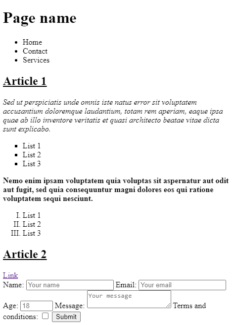
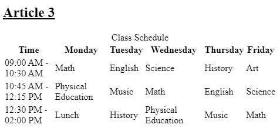
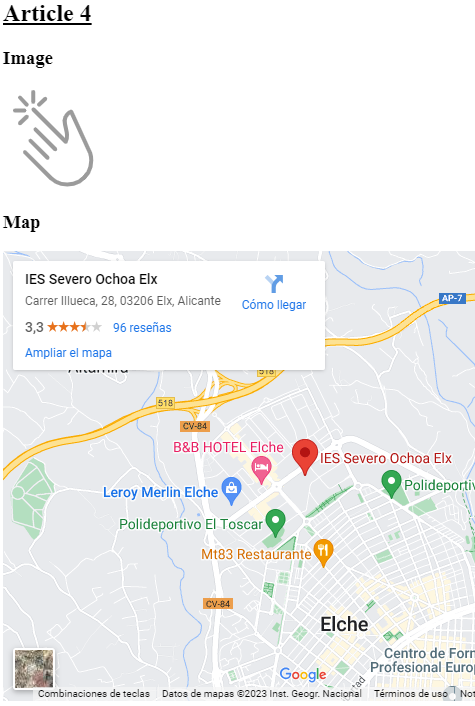
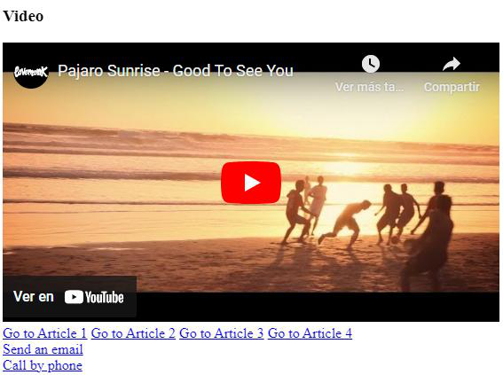

# UP03: HTML II

## Introducción

Con esta unidad terminamos el bloque de HTML. Veremos los elementos de ordenación (bloque y línea), los marcadores o enlaces internos, la metainformación, la metaetiqueta `viewport`, los factores HTML clave para el SEO y cómo validar nuestros documentos. Igual que en las unidades anteriores, los contenidos prácticos están en la web de **Eniun**.

**Recomendaciones**:

- Leed detenidamente el contenido proporcionado y realizad los ejercicios de ejemplo. Algunos podéis verlos directamente en línea desde [CodePen](https://www.eniun.com/tutorial-codepen/).
- Probad todo el código de los ejemplos en vuestro editor y haced cambios sobre él para hacer vuestras propias pruebas. Os recomiendo **Visual Studio Code** con la extensión **Live Preview** o **Live Server**.
- Utilizad las abreviaciones de **Emmet** para escribir HTML más rápido.
- Realizad los ejercicios de refuerzo que encontraréis al final de cada sección.

Cuando terminéis, realizad la **práctica evaluable** de esta unidad y los **tests** disponibles en Aules. Además de la práctica obligatoria, encontraréis ejercicios de ampliación que, aunque no son evaluables, son muy recomendables.

Es muy importante que reviséis y comprendáis los resultados de vuestros tests, ya que la prueba objetiva trimestral será similar a los tests y ejercicios de Aules y a los ejercicios resueltos y propuestos en el contenido de Eniun.

## Contenidos prácticos interactivos (Eniun)

A continuación, tenéis los enlaces a los contenidos que **debéis leer y practicar**:

- [9. Elementos de ordenación](https://www.eniun.com/elementos-ordenacion-html5-bloque-linea/)
- [10. Marcadores HTML](https://www.eniun.com/marcadores-html-enlaces-locales/)
- [11. Factores HTML clave para el SEO](https://www.eniun.com/factores-html-seo-posicionamiento-online/)
- [12. Test de verificación HTML y herramientas útiles](https://www.eniun.com/validador-html-test-de-verificacion/)
- [13. Metainformación en HTML](https://www.eniun.com/metainformacion-html/)
- [14. Metaetiqueta viewport](https://www.eniun.com/configuracion-metaetiqueta-viewport-web-responsive/)
- [15. Resumen de etiquetas HTML](https://www.eniun.com/resumen-etiquetas-html/)
- [16. Ejercicios resueltos HTML](https://www.eniun.com/ejercicios-resueltos-html/)
  - [16.1. Práctica abreviaciones Emmet](https://www.eniun.com/que-son-abreviaciones-emmet-ejemplos-practicos/)

*Los puntos del 1 al 4 los vimos en la [UP01](UP01.md) y los del 5 al 8 en la [UP02](UP02.md). Eniun numera sus apartados de otra forma; los enlaces son los mismos.*

## Práctica evaluable de la unidad

> [!IMPORTANT]
> Esta práctica **SÍ es evaluable** y hay que **entregarla en Aules**. Integra todo lo visto en la UP02 y en la UP03: los puntos 1 a 9 se pueden hacer con los contenidos de la UP02 y el resto con los de esta unidad. Revisad la [rúbrica](#rúbrica-de-evaluación) antes de empezar.

### Ejercicio 1: Página web semántica completa

**Objetivo**

Crear un documento HTML completo, semántico y válido que reúna estructura, texto, listas, enlaces, formularios con validación, tablas, contenido incrustado, marcadores y metainformación.

**Planteamiento**

Crea un documento HTML que contenga los siguientes elementos. Todos los requisitos deben resolverse **solo con HTML, sin CSS**. El tema es libre: puedes reutilizar el videojuego, película o serie de la [UP02](UP02.md) o elegir otro.

> [!NOTE]
> **CSS opcional.** Si os hace ilusión darle algo de estilo a la página para ir practicando, podéis hacerlo, pero con dos condiciones:
>
> - Los estilos van **siempre en una hoja de estilos externa** (por ejemplo, `estilos.css`) enlazada con `<link rel="stylesheet" href="estilos.css">`. **Nada de `<style>` ni de atributos `style="..."`** dentro del HTML.
> - El CSS es solo decorativo: **ningún requisito de la lista puede depender de él**. Si se quita la hoja de estilos, la página tiene que seguir cumpliendo todos los puntos (subrayados, cursivas, negritas, tipos de lista, etc.).
>
> El CSS no suma ni resta nota. Si queréis echar un vistazo antes de la próxima unidad, tenéis [¿Cómo aplicar estilos CSS?](https://www.eniun.com/como-aplicar-estilos-css-html/) en Eniun.

**Tareas**

1. **Cabecera**: un `<header>` con un título `<h1>` y un [menú de navegación](https://www.eniun.com/html5-estructura-basica-elementos-semanticos/) (`<nav>`).
2. **Contenido principal**: un `<main>` con **cuatro artículos** (`<article>`).
3. **Encabezados**: cada artículo debe contener un encabezado `<h2>`.
4. **Subrayado**: cada `<h2>` debe mostrarse [subrayado](https://www.eniun.com/etiquetas-contenido-texto-html/).
5. **Primer artículo**:
    - Dos párrafos: el primero en **cursiva** y el segundo en **negrita**.
    - Después del primer párrafo, una [lista no ordenada](https://www.eniun.com/etiquetas-contenido-texto-html/) de tipo `square`.
    - Después del segundo párrafo, una [lista ordenada](https://www.eniun.com/etiquetas-contenido-texto-html/) con **números romanos**.
6. **Segundo artículo (enlace)**: un [enlace a un documento externo](https://www.eniun.com/etiquetas-contenido-texto-html/) que se abra en una **nueva pestaña** del navegador. Añade también la etiqueta de **salto de línea**.
7. **Segundo artículo (formulario)**: un [formulario](https://www.eniun.com/etiquetas-formularios-html5/) con los siguientes campos:
    - **Nombre**: 30 caracteres como máximo; solo permite letras y números.
    - **Email**.
    - **Edad**: entre 18 y 99 años.
    - **Consulta**: campo de texto largo.
    - **Checkbox** de aceptación de la política de privacidad y cookies.

    Además:
    - Todos los campos son **obligatorios**.
    - El **foco** debe estar en el campo "Nombre" al cargar la página.
    - Todos los campos deben tener `placeholder` y una `<label>` asociada (`for`/`id`).
    - Usa **patrones** (`pattern`) con expresiones regulares para validar los campos cuyo `type` no los valide por sí mismo.
8. **Tercer artículo**: una [tabla](https://www.eniun.com/etiquetas-tablas-contenido-html5/) con un **horario**. Incluye encabezados `<th>` y un **título de tabla** (`<caption>`).
9. **Cuarto artículo**: los siguientes [contenidos incrustados](https://www.eniun.com/contenido-incrustado-html5/): una **imagen externa**, un **mapa de Google Maps** y un **vídeo de YouTube**.
10. **Aside**: un `<aside>` con enlaces internos que lleven a cada uno de los artículos mediante [marcadores](https://www.eniun.com/marcadores-html-enlaces-locales/) (`#id`).
11. **Pie de página**: un `<footer>` con un enlace para **enviar un correo electrónico** y otro para **llamar por teléfono**, usando los valores correspondientes en el [atributo `href`](https://www.eniun.com/marcadores-html-enlaces-locales/).
12. **Favicon**: incluye un [favicon](https://www.eniun.com/metainformacion-html/).
13. **Metainformación**: añade las [etiquetas de metainformación](https://www.eniun.com/metainformacion-html/) `<title>`, `<meta charset>`, `<meta name="description">`, `<meta name="author">` y [`<meta name="viewport">`](https://www.eniun.com/configuracion-metaetiqueta-viewport-web-responsive/). Define el ancho igual al ancho del dispositivo; el resto de valores, según tu criterio.

Utiliza siempre que puedas [elementos semánticos](https://www.eniun.com/html5-estructura-basica-elementos-semanticos/), [valida el documento HTML](https://www.eniun.com/validador-html-test-de-verificacion/) y ten en cuenta los [factores HTML clave para el SEO](https://www.eniun.com/factores-html-seo-posicionamiento-online/).

> [!TIP]
> - Genera la estructura básica con la abreviación Emmet `!` y el esqueleto de los artículos con algo como `main>article*4>h2`.
> - Para los artículos y el `<aside>`, recuerda que el `id` del destino debe coincidir con el `href="#..."` del enlace.
> - Valida el documento con el [validador del W3C](https://validator.w3.org/#validate_by_input). Los códigos de inserción que generan Google Maps y YouTube suelen traer atributos obsoletos (`frameborder`) o estilos en línea (`style="border:0;"`); elimínalos para que el documento valide y para no tener estilos dentro del HTML.
> - Fíjate en qué campos del formulario necesitan `pattern` y cuáles no: `type="email"` y `type="number"` (con `min` y `max`) ya validan por sí mismos.

> [!NOTE]
> El atributo `type` de `<ul>` está **obsoleto** en HTML5 y el validador del W3C lo marcará. Como en esta práctica los requisitos se resuelven solo con HTML (la forma moderna de cambiar el marcador de una lista es CSS), **ese aviso concreto se acepta**. El resto del documento debe validar sin errores. El atributo `type` de `<ol>`, en cambio, sí es válido.

**Ejemplo de resultado**

Este es un ejemplo orientativo del aspecto que puede tener la página. Fíjate en que, sin CSS, el navegador aplica sus estilos por defecto:

**Instrucciones de entrega**

Entrega en Aules un **único archivo `.zip`** con la carpeta de tu práctica. No subas los archivos sueltos.

- El archivo HTML debe llamarse `UP03nombreyprimerapellido.html` (por ejemplo, `UP03anagarcia.html`) y el `.zip`, igual pero con extensión `.zip` (`UP03anagarcia.zip`).
- El `.zip` debe contener **tanto el archivo `.html` como el favicon**. Sin el favicon, la página no lo mostrará al abrirla y ese punto no se podrá evaluar.
- Si has usado la hoja de estilos opcional, inclúyela también en el `.zip`.
- Usa una **ruta relativa** para el favicon (por ejemplo, `<link rel="icon" href="favicon.ico">`) y deja ambos archivos en la misma carpeta, para que funcione al descomprimir el `.zip` en cualquier ordenador.

> [!TIP]
> Antes de subirlo, comprueba tu `.zip`: descomprímelo en otra carpeta, abre el `.html` en el navegador y verifica que se ve el favicon en la pestaña.

### Rúbrica de evaluación

| Criterio | Descripción | Puntos |
|---|---|---:|
| **Estructura, semántica y SEO** | Estructura general del documento HTML, uso de etiquetas semánticas, metainformación, favicon, optimización para SEO (títulos, metaetiquetas) y validación HTML. | 30 |
| **Contenido principal (artículos)** | Cuatro artículos con `<h2>` subrayados; primer artículo con párrafos en cursiva/negrita y listas; segundo artículo con enlace externo, salto de línea y formulario; tercer artículo con tabla de horario; cuarto artículo con imagen, mapa de Google Maps y vídeo de YouTube. | 30 |
| **Interactividad y navegación** | Cabecera con `<h1>` y menú de navegación, `<aside>` con enlaces internos a los artículos, enlaces externos en el contenido y `<footer>` con enlaces funcionales de correo electrónico y llamada telefónica. | 20 |
| **Formulario del segundo artículo** | Cumple todas las especificaciones: validación, `<label>`, `placeholder`, foco en el campo "Nombre", uso de patrones para los inputs y todos los campos obligatorios. | 20 |
| | **Total** | **100** |

## Actividades de ampliación

> [!NOTE]
> Estas actividades **NO son evaluables** y **no hay que entregarlas**, pero son muy recomendables para afianzar lo aprendido.

### Ejercicio 2: Ejercicios resueltos y propuestos de Eniun

Haz los [ejercicios resueltos de HTML de Eniun](https://www.eniun.com/ejercicios-resueltos-html/) y los ejercicios propuestos sin resolver que se encuentran al final de la página (ejercicios 8, 9 y 10).

### Ejercicio 3: CodePen

Crea una cuenta en [CodePen](https://codepen.io/) y haz lo siguiente:

1. Crea una colección con el nombre "HTML" (u otro que te apetezca).
2. Crea un *pen* con código HTML y ponle un nombre.
3. Añade el *pen* a la colección.
4. Sigue la cuenta de Eniun ([codepen.io/Eniun](https://codepen.io/Eniun/)) desde tu perfil.
5. Explora *pens* de otros desarrolladores y añade a favoritos algunos proyectos que te resulten interesantes.

Si quieres, puedes incluir un enlace a tu cuenta de CodePen junto a la entrega de la práctica en Aules. Si lo necesitas, tienes un [tutorial de CodePen](https://www.eniun.com/tutorial-codepen/) en Eniun.

*Puedes eliminar tu cuenta y todo lo que hayas hecho en ella si la herramienta no te resulta interesante.*

### Ejercicio 4: Abreviaciones Emmet

Después de familiarizarte con las [abreviaciones Emmet](https://www.eniun.com/que-son-abreviaciones-emmet-ejemplos-practicos/), úsalas constantemente en tu código. Con la práctica irás ganando velocidad al crear estructuras HTML y, más adelante, estilos CSS. Practica con los [ejemplos prácticos de abreviaciones Emmet](https://www.eniun.com/que-son-abreviaciones-emmet-ejemplos-practicos/) de Eniun.

## Repaso de HTML: vídeo recomendado

Ahora que hemos terminado de ver todo el HTML, os recomiendo este vídeo de **midudev**, un referente en el desarrollo web:

En unas dos horas sintetiza prácticamente todo lo que hemos cubierto de HTML y refuerza la importancia de la **semántica**. La mayoría de las cosas ya las sabréis, pero estoy seguro de que, si lo veis, aprenderéis algo nuevo. 🙂

## Para ir adelantando: CSS

Si os apetece empezar con los contenidos de la próxima unidad, podéis ir leyendo los primeros apartados del tutorial de CSS de Eniun:

- [1. ¿Qué es CSS?](https://www.eniun.com/que-es-css-cascading-style-sheets/)
- [2. ¿Cómo aplicar estilos CSS?](https://www.eniun.com/como-aplicar-estilos-css-html/)
