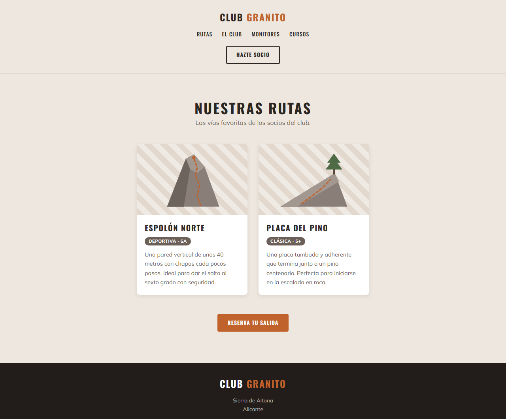
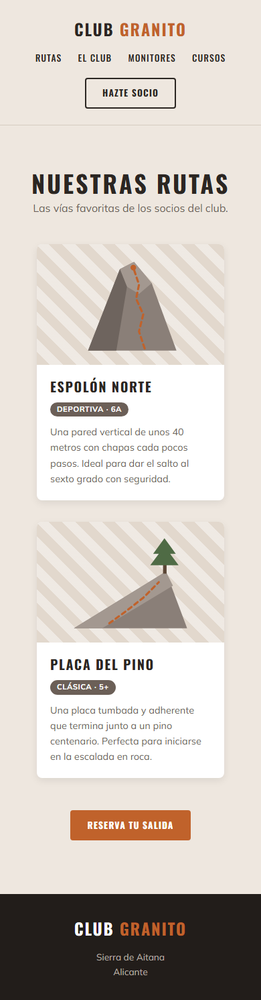

# UP04: Hojas de estilos I

## Introducción

En esta unidad arrancamos con **CSS**. Hasta ahora hemos trabajado mucho la **semántica** en HTML y su importancia para la accesibilidad y para el tratamiento automático que las herramientas informáticas (buscadores, lectores de pantalla, etc.) pueden hacer de la web. Ahora es el momento de darle **estilo y estética** a nuestra información. Igual que en las unidades anteriores, los contenidos prácticos están en la web de **Eniun**.

**Recomendaciones**:

- Leed detenidamente el contenido proporcionado y realizad los ejercicios de ejemplo. Algunos podéis verlos directamente en línea desde [CodePen](https://www.eniun.com/tutorial-codepen/).
- Probad todo el código de los ejemplos en vuestro editor y haced cambios sobre él para hacer vuestras propias pruebas. Os recomiendo **Visual Studio Code** con la extensión **Live Preview** o **Live Server**.
- Usad las **herramientas de desarrollo** del navegador (<kbd>F12</kbd>) para inspeccionar los estilos que se aplican a cada elemento y probar cambios en directo.
- Utilizad las abreviaciones de **Emmet**, que también funcionan en CSS.
- Realizad los ejercicios de refuerzo que encontraréis al final de cada sección.

En esta unidad **no hay práctica evaluable**: estamos empezando con CSS y toca coger soltura. Cuando terminéis los contenidos, realizad las [actividades formativas](#actividades-formativas-de-la-unidad) que tenéis más abajo. No se entregan, pero están pensadas a partir de cómo suelen ser los exámenes, así que son **muy recomendables**.

Es muy importante que reviséis y comprendáis los resultados de vuestros tests, ya que la prueba objetiva trimestral será similar a los tests y ejercicios de Aules y a los ejercicios resueltos y propuestos en el contenido de Eniun.

## Contenidos prácticos interactivos (Eniun)

A continuación, tenéis los enlaces a los contenidos que **debéis leer y practicar**:

- [1. ¿Qué es CSS?](https://www.eniun.com/que-es-css-cascading-style-sheets/)
- [2. ¿Cómo aplicar estilos CSS?](https://www.eniun.com/como-aplicar-estilos-css-html/)
- [3. Selectores](https://www.eniun.com/selectores-css-tipos/)
- [4. Unidades de medida](https://www.eniun.com/unidades-medida-css/)
  - [4.1. Unidades vh y vw](https://www.eniun.com/unidades-vh-vw-css/)
- [5. Colores y fondo](https://www.eniun.com/atributos-propiedades-colores-css/)
  - [5.1. Efecto parallax](https://www.eniun.com/como-crear-efecto-parallax-html-css/)
- [6. Propiedades de texto](https://www.eniun.com/atributos-propiedades-textos-css/)
- [7. Propiedades de las fuentes](https://www.eniun.com/atributos-propiedades-fuentes-css/)
- [8. Propiedades de las listas](https://www.eniun.com/atributos-propiedades-listas-css/)
- [9. Modelo de cajas: márgenes, relleno y bordes](https://www.eniun.com/modelo-cajas-css-margenes-relleno-bordes/)
- [10. Tamaño: width, height, max-width…](https://www.eniun.com/propiedades-width-height-max-width-min-height/)

*Los puntos 1 y 2 ya los dejamos enlazados al final de la [UP03](UP03.md) para quien quisiera ir adelantando.*

## Refuerzo: vídeo recomendado

Para reforzar estos contenidos os recomiendo el curso de CSS de **midudev**:

[](https://www.youtube.com/watch?v=TlJbu0BMLaY)

> [!TIP]
> Para esta unidad, vedlo **desde el principio hasta aproximadamente la 1h 50min**, justo hasta el final del **modelo de caja** y antes de que empiece con los **desbordamientos** (*overflow*). El resto del vídeo lo iremos aprovechando en las próximas unidades.

## Actividades formativas de la unidad

> [!IMPORTANT]
> Estas actividades **NO son evaluables** y **no hay que entregarlas**. Son ejercicios para practicar lo que habéis visto en Eniun. Aunque no se entreguen, la actividad 2 sigue el **formato del examen**, así que insisto en la importancia de realizarla. Al final tenéis una **solución de ejemplo**: intentad hacerla primero por vuestra cuenta y usad la solución solo para comparar. Por supuesto quedo a vuestra disposición para cualquier duda que tengáis.

### Actividad 1: Practica los selectores con CSS Diner

**Objetivo**

Dominar los selectores CSS de forma visual y jugando.

**Planteamiento**

[CSS Diner](https://flukeout.github.io/) es un juego en el que tienes que escribir el selector CSS que coge exactamente los platos, manzanas y pepinillos que se están moviendo sobre la mesa. Tiene **32 niveles**, que empiezan con selectores de tipo, clase e id y terminan con combinadores, pseudoclases y selectores de atributo.

**Tareas**

1. Juega los niveles en orden. A la derecha de cada nivel tienes la explicación del selector que se practica.
2. Intenta llegar al menos hasta el **nivel 20**. Los últimos son más avanzados, pero merece la pena intentarlos.
3. Cuando un nivel se te atasque, vuelve al apartado [3. Selectores](https://www.eniun.com/selectores-css-tipos/) de Eniun antes de buscar la solución.

> [!TIP]
> El juego guarda tu progreso en el navegador, así que puedes dejarlo a medias y seguir otro día.

### Actividad 2: Maquetación de la web de un club de escalada

**Objetivo**

Dar estilo a una página HTML ya hecha **sin tocar el HTML**, solo con una hoja de estilos externa. Es el formato habitual del examen: te dan el HTML y una imagen del resultado, y tú escribes el CSS.

**Planteamiento**

Tienes la web del **Club de escalada Granito** en [recursos/UP04/club-granito](recursos/UP04/club-granito/). Descarga el archivo `index.html` y la carpeta `img` con sus dos imágenes. El HTML ya enlaza una hoja de estilos `estilos.css`, que es la que tienes que crear en la misma carpeta.

En el examen la cabecera y las tarjetas se colocan en fila con **flexbox** y hay **puntos de ruptura** para el móvil. Eso lo veremos en las próximas unidades. Aquí vamos a maquetar la página con lo que hemos visto en esta unidad y unas pocas propiedades nuevas, que tienes explicadas más abajo. El resultado se parece mucho a la **versión móvil** de un examen y, en pantallas anchas, las tarjetas se colocan una al lado de la otra sin necesidad de flexbox.

**Resultado esperado**

| Escritorio | Móvil |
|---|---|
|  |  |

**Guía de estilo: colores**

| Uso | Color |
|---|---|
| Fondo de la página | `#eee7df` |
| Texto principal | `#2b2622` |
| Color de acento (logo, botón principal) | `#c0622b` |
| Acento oscuro (botón principal al pasar el ratón) | `#9e4e20` |
| Texto secundario y fondo de las etiquetas | `#6b5f57` |
| Borde inferior de la cabecera | `#d6cbc0` |
| Fondo de las tarjetas | `#ffffff` |
| Fondo de las imágenes de las tarjetas | `#e2d8cd` |
| Fondo del pie | `#221d1a` |
| Texto del pie | `#b8aea5` |

> [!NOTE]
> Fíjate en que varios colores se repiten en muchas reglas: si mañana cambia el color de acento, tendrías que buscarlo y cambiarlo en varios sitios. Para eso existen las **variables CSS** (por ejemplo, `--color-acento: #c0622b;`), que permiten definir un valor una vez y reutilizarlo. No están en los contenidos de esta unidad: **las veremos más adelante**. De momento, escribid los colores en hexadecimal directamente.

**Cosas nuevas que vas a necesitar**

Casi todo se resuelve con los apartados 1 a 10 de Eniun. Las siguientes propiedades todavía no las habéis visto en Eniun (algunas aparecen en el vídeo de midu). Aquí tenéis lo justo para usarlas en esta actividad:

| Para… | Código | Explicación |
|---|---|---|
| Usar fuentes de Google Fonts | `@import url("…");` | Carga una hoja de estilos externa desde tu CSS. Tiene que ir en la **primera línea** del archivo. |
| Cambiar el estilo al pasar el ratón | `.menu a:hover { … }` | `:hover` es una **pseudoclase**: la regla solo se aplica mientras el ratón está encima. Las veremos a fondo más adelante (apartado 13 de Eniun). |
| Cambiar cómo se coloca un elemento | `display: block;` / `display: inline-block;` | En la UP03 vimos que hay elementos de **bloque** y de **línea**. Con `display` se cambia ese comportamiento. `inline-block` coloca los elementos uno al lado del otro, como texto, pero respetando su `width`, `padding` y `margin`. |
| Alinear por arriba elementos `inline-block` | `vertical-align: top;` | Por defecto se alinean por abajo, como las letras de una línea de texto. |
| Que el `width` incluya relleno y borde | `box-sizing: border-box;` | Por defecto, `width` mide solo el contenido y el relleno y el borde se suman por fuera. Con `border-box`, una caja con `width: 280px` mide 280 px en total. |
| Que un elemento no se salga de su contenedor | `max-width: 100%;` | Como el `max-width` del apartado 10 de Eniun, pero en porcentaje del ancho del contenedor. |
| Añadir una sombra | `box-shadow: 0 4px 12px rgba(0, 0, 0, 0.08);` | Desplazamiento horizontal, desplazamiento vertical, desenfoque y color (negro con un 8 % de opacidad). |

**Tareas**

1. **Hoja de estilos externa**: crea `estilos.css`. No escribas nada de CSS en el HTML (ni `<style>` ni atributos `style`) y **no modifiques el HTML**: todo se resuelve con los selectores adecuados.
2. **Fuentes**: escribe esta línea al principio del CSS para importar Oswald y Mulish desde [Google Fonts](https://fonts.google.com/):

    ```css
    @import url("https://fonts.googleapis.com/css2?family=Mulish:wght@400;700&family=Oswald:wght@500;700&display=swap");
    ```

3. **Modelo de caja**: con el **selector universal**, aplica `box-sizing: border-box` a todos los elementos.
4. **Estilos generales** (`body`):
    - Sin margen exterior.
    - Color de fondo y color de texto principal de la guía de estilo.
    - Fuente `"Mulish", Arial, sans-serif` de `16px` e interlineado de `1.6`.
5. **Titulares**: con **un único selector agrupado** para `h1`, `h2`, `.logo`, `.menu a` y `.boton`, aplica la fuente `"Oswald", "Arial Narrow", sans-serif`, todo en mayúsculas y un espaciado entre letras de `0.08em`.
6. **Cabecera** (`.cabecera`):
    - Relleno de `24px` arriba y abajo y `16px` a los lados, texto centrado y un borde inferior sólido de `1px`.
    - Logo (`.logo`): sin margen salvo `12px` por debajo, tamaño `1.5rem` y en negrita (`700`).
    - La palabra "Granito" va en el color de acento. Pista: está dentro de un `<span>`; usa un **selector descendiente**.
7. **Menú de navegación** (`.menu`):
    - La lista: sin viñetas, sin relleno y sin margen salvo `16px` por debajo.
    - Cada elemento de la lista: `inline-block`, con un margen de `10px` a izquierda y derecha.
    - Los enlaces: color de texto principal, tamaño `0.85rem` y sin subrayado. Al pasar el ratón, color de acento.
8. **Botones**: los dos botones comparten la clase `boton` y cada uno tiene una clase de variante.
    - `.boton`: `inline-block`, relleno de `10px` arriba y abajo y `24px` a los lados, esquinas redondeadas de `4px`, tamaño `0.85rem`, negrita (`700`) y sin subrayado.
    - `.boton-borde`: borde sólido de `2px` y texto, ambos en el color de texto principal. Al pasar el ratón, el fondo pasa a ser de ese color y el texto, blanco.
    - `.boton-relleno`: fondo y borde sólido de `2px` en el color de acento y texto blanco. Al pasar el ratón, fondo y borde en el acento oscuro. El borde, aunque sea del mismo color que el fondo, hace que los dos botones tengan el mismo tamaño.
9. **Sección de rutas** (`.rutas`):
    - Ancho máximo de `960px`, centrada en la página con `margin: 0 auto`, relleno de `64px` arriba y abajo y `16px` a los lados, y texto centrado.
    - El `h1`: sin margen, tamaño `2.25rem` e interlineado de `1.2`.
    - El subtítulo (`.subtitulo`): margen de `4px` arriba, `0` a los lados y `40px` abajo, en el color de texto secundario.
10. **Tarjetas** (`.tarjeta`):
    - `inline-block`, alineadas por arriba, de `280px` de ancho pero con un ancho máximo del `100%`.
    - Margen de `0` arriba, `12px` a los lados y `32px` abajo.
    - Fondo blanco, esquinas redondeadas de `8px`, la sombra de la tabla anterior y texto alineado a la izquierda.
    - La imagen (`.tarjeta img`): `display: block`, `100%` de ancho, `180px` de alto, relleno de `16px`, el fondo indicado en la guía y esquinas redondeadas de `8px` **solo arriba** (`8px 8px 0 0`).
    - El cuerpo de la tarjeta (`.tarjeta-cuerpo`): relleno de `20px`.
    - El `h2`: margen de `8px` solo por debajo, tamaño `1.25rem` e interlineado de `1.2`.
    - La descripción (`.descripcion`): sin margen, color de texto secundario y tamaño `0.9rem`.
11. **Etiqueta de tipo de vía** (`.etiqueta`): convierte el párrafo en una "píldora":
    - `inline-block`, margen de `12px` solo por debajo y relleno de `2px` arriba y abajo y `10px` a los lados.
    - Fondo de color secundario y esquinas redondeadas de `999px` (un valor muy grande redondea los extremos por completo).
    - Texto blanco, de `0.7rem`, en negrita, en mayúsculas y con un espaciado entre letras de `0.05em`.
12. **Pie de página** (`.pie`):
    - Relleno de `32px` arriba y abajo y `16px` a los lados, fondo y color de texto del pie y texto centrado.
    - El logo del pie va en blanco, salvo "Granito", que sigue en el color de acento. Pista: el selector `.pie .logo` es más **específico** que `.logo` y gana aunque los dos den color al logo.
    - La dirección (`.direccion`): sin margen y tamaño `0.85rem`.
13. **Validación**: valida tu hoja de estilos con el [validador CSS del W3C](https://jigsaw.w3.org/css-validator/#validate_by_input).

> [!TIP]
> - Ve de lo general a lo particular: primero el `body` y los titulares, después la cabecera, las tarjetas y el pie. Recarga el navegador después de cada bloque.
> - Fíjate en cuántos valores tiene cada `margin` y `padding`: con dos valores, el primero es arriba y abajo y el segundo, los lados; con tres, arriba, los lados y abajo.
> - Para comprobar la versión móvil, abre las herramientas de desarrollo y activa la **vista de dispositivo** (<kbd>Ctrl</kbd> + <kbd>Shift</kbd> + <kbd>M</kbd>). Si las tarjetas se salen de la pantalla, revisa el `max-width` y el `box-sizing`.
> - Cuando termines, quita un momento el `box-sizing` y mira en las herramientas de desarrollo (pestaña *Elementos* → *Calculado*) cómo cambia el ancho real de la imagen y de la tarjeta.
> - Emmet también funciona en CSS: escribe `m0` y pulsa <kbd>Tab</kbd> para obtener `margin: 0;`, `p20` para `padding: 20px;` o `bgc` para `background-color`.

**Reto opcional: fondo de rayas**

Las imágenes de las tarjetas del resultado tienen un fondo de **rayas diagonales**. No hace falta ninguna imagen: se consigue con un **degradado** repetido encima del color de fondo. Los degradados no los hemos visto todavía, así que aquí tienes el código:

```css
background-image: repeating-linear-gradient(
  45deg,
  transparent 0 14px,
  rgba(255, 255, 255, 0.45) 14px 28px
);
```

Se lee así: rayas a `45deg` que alternan una franja transparente (de `0` a `14px`, por la que se ve el color de fondo) y una franja blanca semitransparente (de `14px` a `28px`). Prueba a cambiar el ángulo, el ancho de las rayas o la transparencia para ver cómo cambia el resultado.

**Solución de ejemplo**: [estilos.css](soluciones/UP04/estilos.css). Para verla funcionando, cópiala en la carpeta del `index.html`.
